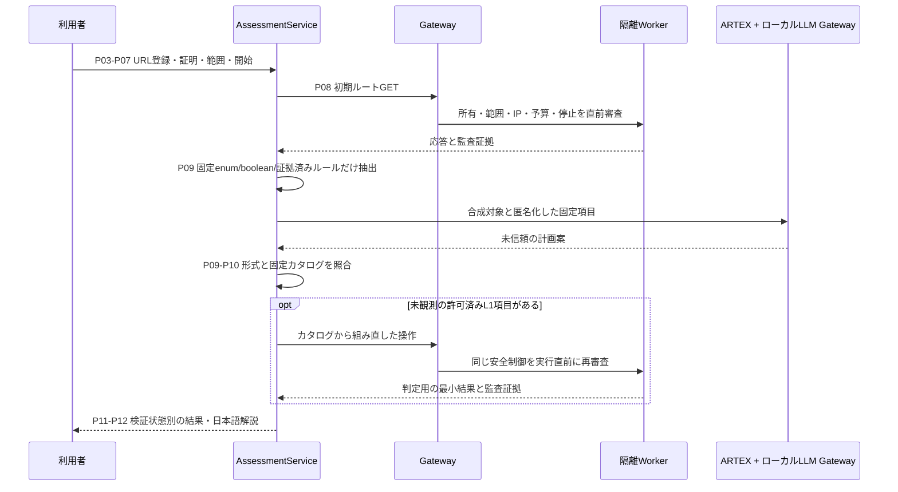

# 初回診断へのARTEX接続: 独立レビュー用設計

対象ブランチ: `codex/initial-artex-plan-review`。これは**設計と合格条件**であり、実サイトでの追加検査を有効化する変更ではない。起点は [処理系統監査](PROCESS_AUDIT.md) のP07–P12。

## 現在の制約と、変更が必要な理由

`AssessmentService._run_inner`は初回診断で固定のルートGETを1回行い、その応答を`_analyze`で判定する。実サイト向け`plan_with_artex`は診断完了後に利用者が呼ぶ。`artex_bridge.CATALOG`の実サイトで許可されるL1は`l1_http_probe`だけで、同じルートGETをもう1回行う。既存の模擬E2Eテストも、計画前に1回、項目実行後に2回目のGETを記録している。この構造では本物ARTEXが計画しても、確認済みの脆弱性は増えない。IDOR・SQLiの実証はL2に当たり、実サイトでは今後も禁止する。

初回へARTEXを移すだけでは完成条件を満たさない。**新たなL1検査は固定カタログ、独立した正解ラベル、追加通信の上限を揃えてから**段階的に導入する。初回ARTEXは設定済みのローカルモデルのみを使い、外部モデル接続を許可しない。Abliteration AIによる日本語解説は別経路で、送信許可済み固定項目と費用上限を確認できるまで公開βでは無効のままにする。

## 実装順とデータ境界

1. P03–P07: URL登録、組織所属、所有証明、診断範囲、期限、禁止事項への同意を既存APIで確定する。所有確認・範囲確定前には初期観測も行わない。
2. P08: Gatewayが実行直前に所有・範囲・DNS/IP・回数・緊急停止を確認し、隔離WorkerでルートGETを**1回**行う。リダイレクトを追わず、Workerの読取上限を維持する。
3. P09: 応答を制御プレーン内で解析し、ARTEX入力用の固定スキーマだけを作る。初版の許可項目は`scheme=https/http`、`status_class=2xx/3xx/4xx/5xx`、`server_family=apache/nginx/other/unknown`、`tls_present=true/false`、`hsts_present=true/false`、`csp_present=true/false`、証拠のある所見の固定ルールIDと判定状態に限る。ヘッダー値、ホスト名、URL、パス、Cookie、認証情報、個人情報、応答本文、証拠本文は含めない。送信前にシリアライズ済み本文へ漏えい検査を適用し、許可された形以外ならAI計画を中止する。
4. P09: ARTEXは固定の合成対象`lab.test`と上記情報をローカルLLM Gatewayから受け取る。プランナーの実行権限・対象へのネットワーク到達・Workerトークンは与えない。呼出回数、出力長、所要時間、プロセス隔離、緊急停止を既存の上限に従わせる。失敗時は固定L1結果を確定し、AI計画失敗を監査に残す。
5. P09–P10: `reconstruct`と`ProposalRouter`でARTEXの未信頼出力を固定カタログへ照合する。実サイトではL1以外を助言に落とし、AIのURL・引数は使わない。初回GETに相当する項目は「観測済み」として追加Workerを起動しない。新しいL1項目だけGatewayへ渡す。
6. P10–P12: Gatewayは**各実行直前**に権限、対象、DNS/IP、通信予算、期限、停止世代を再検証する。Workerの結果は証拠と監査ハッシュに紐付ける。AI提案は`candidate`、実応答による確認は`detected`、実サイトでは`proven`にしない。結果画面は実際の診断エンジンとモデルを表示する。利用者の基本操作はURL入力→所有確認→診断開始→結果表示のままにする。

## 最初の追加L1候補: Apache mod_statusの公開露出

独立レビューに出す具体例は、Apache系と観測された対象に限り、固定パス`/server-status?auto`へ最大1回のGETを提案できるようにする案。これは**未実装・実サイトでは無効**。HTTP 200だけでは検出とせず、mod_status固有の複数の固定マーカーをWorker内部で確認する。403、404、汎用200、タイムアウト、リダイレクトは検出済みにしない。失敗や未観測を「安全」とも表示しない。

同じ`http_probe` Workerを再利用し、この項目だけ本文を「マーカー判定」モードで処理する。Workerから制御プレーンへ返すのはHTTP状態、検査ID、マーカー一致の真偽、通信時間、固定のエラー種別のみ。生の本文、サーバー内のURL、接続中クライアントのIP、セッション情報をWorker出力・監査ログ・AI入力に残さない。実際のURLは登録済みのscheme/host/portとカタログの固定パスからVulnixが構成し、ARTEXの文字列を使わない。GatewayとWorkerのDNS固定、リダイレクト禁止、読取上限、隔離、停止処理は維持する。

この例はレビューで安全性が認められた場合だけ実装する。別のL1項目に替える場合も、**一つの正解ラベルを持つ独立ラボ、Worker内の最小応答化、追加通信1回の上限**を先に定義する。

## 独立ラボと合格条件

| ケース | 正解ラベル・期待動作 |
|---|---|
| Apacheヘッダー + mod_status公開の脆弱ラボ | ARTEXが候補を提案し、Gatewayが固定パスGETを許可、Workerの複数マーカー一致でのみ`detected`。証拠ID・監査ハッシュあり |
| 同一Apacheヘッダー + mod_statusを403にした修正済みラボ | 同じ計画・同じ追加GETを行い、検出0件。候補は候補のまま |
| Apacheを名乗るが汎用200を返す修正済みラボ | 本文の単語一つやHTTP 200だけで誤検知しない |
| Apache以外のラボ | ARTEXが対象に応じて追加GETを提案しない。提案したとしてもカタログの条件で実行しない |
| AIの異常出力・不正なURL/パス/対象・L2案 | すべて拒否または参考案。Worker起動0、AI案を検出済み扱いしない |
| 所有未確認・期限切れ・組織違い・停止との競合・DNS/IP変更 | 計画中または実行直前に拒否。失効後の結果を採用しない |
| Worker応答にURL・IP・個人情報・秘密情報を混入 | 返却値と監査・AI送信プレビューに残らないことを確認 |
| ARTEX停止・モデルタイムアウト・費用上限超過 | 固定L1結果は保持、追加通信なし、失敗を監査。実サイトL2は常時拒否 |

**期待値を後から実装に合わせて弱めない。** 先に独立した脆弱・修正済みラボと固定ラベルを追加し、変更前の同一ラボを測る。変更後は同じラボ・同じ状態で、診断完了時間、対象GET数、Gateway許可/拒否、Worker起動、JSON状態保存、AI呼出/トークン、正解ラベル別TP/FP/FN/TN/未計測、利用者クリック、安全制御の拒否率を採取する。推定費用は確認できる単価があるときだけ計算する。候補をTPに数えず、未検証をTNに数えない。検出精度が下がる、漏えいが起きる、失効・停止後に起動する、または予算を超える場合は採用しない。

独立ラボの初期版は`tests/fixtures/status_exposure_lab.py`で、全モードのルート応答とApacheヘッダーを同一にし、固定パスだけを公開200+複数マーカー、修正済み403、汎用200の三種類に分けた。`VULNIX_NO_ENV_LOCAL=1 python3 -m scripts.bench_status_exposure_baseline`による**変更前**の各1回の直近測定は、脆弱0.071秒、修正済み0.071秒、汎用200が0.074秒。全モードで対象GETは`/`の1回、Gateway 1回、Worker起動1回、診断中の状態保存メソッド呼び出し15回、ARTEX・外部モデル呼び出しとAIトークンは0。mod_status公開の検出は全モード0件。この1クラスのラベルは脆弱側1、正常側2なので、現行L1はTP0/FP0/FN1/TN2、Recall 0%、誤検知率0%。検出が1件もないためPrecisionは未定義であり、100%とも0%とも表示しない。これは3つの模擬対象であり一般サイトの精度ではない。ルートページ共通の他の所見は、このクラスのTP/FPに混ぜない。所有範囲の期限切れ・所有確認の取消しを別々に試すと、2件とも診断開始を拒否し、Worker起動と対象通信は0件だった。この2件の拒否率は2/2であり、安全制御全体の成功率ではない。HTTP API回数とユーザー操作数はこのサービス直呼びベンチマークでは測れない。変更後もラボと正解ラベルを変えずに比較する。

## レビューで確定する点

- mod_status確認が公開βの「低負荷・読み取り専用」の許可範囲に入るか。入らなければ別の固定L1項目を選ぶ。
- `server_family=apache`の判定を、偽装・未設定のServerヘッダーでも安全に扱えるか。
- Workerの最小応答が、利用者に示せる証拠として十分か。生本文を保存せずに再現可能性を示せるか。
- 初回計画のタイムアウトと追加通信上限を、既存の組織・全体の制限にどう合算するか。
- 外部Abliteration AI解説の固定送信項目とドル建て上限。公開βではレビュー完了まで無効。

独立レビュー、同一ラボの前後比較、明示的な公開承認が揃うまで、この案を公開βや実サイトの実行経路へ接続しない。
