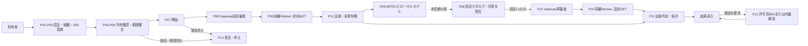
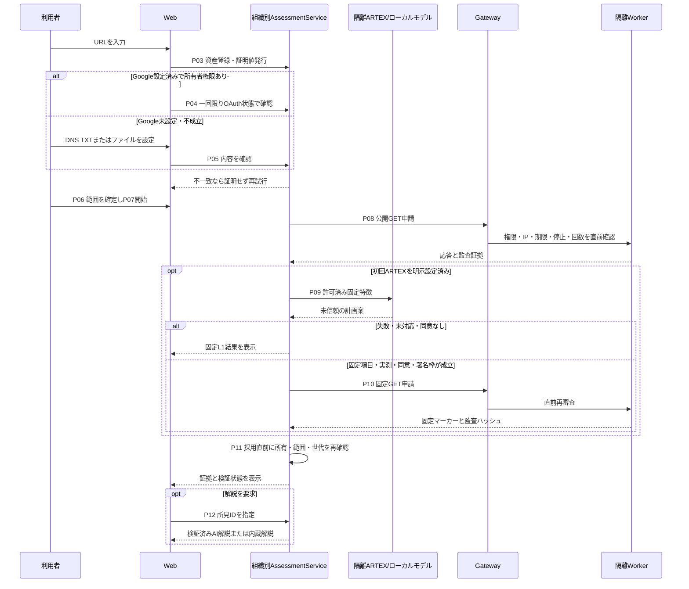
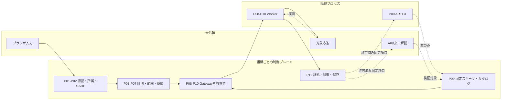

# 現行開発コードの処理系統

この文書はDraft PR #53〜#59を重ねたコード経路を示す。公開βへ反映済みという意味ではない。全関数・API条件・通信・ジョブの静的列挙は[PROCESS_INVENTORY.json](PROCESS_INVENTORY.json)、履歴と重複候補は[PROCESS_AUDIT.md](PROCESS_AUDIT.md)、同一ラボ測定は[STATUS_EXPOSURE_INTEGRATION.md](STATUS_EXPOSURE_INTEGRATION.md)。静的列挙だけでは動的URLや実行時設定を解決できないため、以下をコードと照合した。

## 構成

公開βの操作は「URL入力→所有確認→診断開始→結果表示」。Google所有確認は設定時だけ表示し、未設定ならDNS TXTまたはファイル方式を使う。URL登録では診断通信をしない。追加の`/server-status?auto` GETは設定、明示同意、署名付き範囲と診断枠、Apache系の初回実測、ARTEXの固定カタログ案がすべて揃った場合だけ実行する。実サイトL2は禁止。

## 操作・条件と発火する処理

表中のサーバールートは[`aegis/server.py`](../aegis/server.py)、`AssessmentService`の関数は[`aegis/assessment.py`](../aegis/assessment.py)、Gatewayは[`aegis/gateway.py`](../aegis/gateway.py)、隔離Workerは[`aegis/runtime.py`](../aegis/runtime.py)と[`aegis/workers`](../aegis/workers)、ARTEX変換は[`aegis/artex_bridge.py`](../aegis/artex_bridge.py)、画面は[`web/src`](../web/src)にある。機械抽出JSONにはファイルと行番号が入っている。

| ID | APIまたは条件 | 主な関数 | 主なテスト・通信 |
|---|---|---|---|
| P01 | `/api/auth/register`, `/login`、MFA等 | `server.py` `_register`, `_login`, `do_POST`、`SessionProvider` | `test_server.py`, `test_tenancy.py`。Host・Origin・CSRF・セッション |
| P02 | `/api/orgs/*` | `_bind`, `_get_org`, `_dispatch`, `TenantRegistry.service` | `test_tenancy.py`。組織別のサービスへ限定 |
| P03 | `/api/assets/challenge` | `OwnershipWizard.issue` → `issue_ownership_challenge` | `test_real_service.py`。資産・証明値保存。対象通信なし |
| P04 | Google設定時 `/api/assets/google/start`, `/finish` | `google_ownership.py` → `verify_asset_ownership` | `test_tenancy.py`。Google OAuth / Search Console。公開βでは未設定 |
| P05 | `/api/assets/verify-ownership` | `OwnershipWizard.verify` → `verify_asset_ownership` | `test_real_service.py`。DNS照会または確認ファイルGET。不一致なら証明しない |
| P06 | `/api/assets/confirm-scope` | `OwnershipWizard.confirmScope` → `confirm_asset_scope` | `test_authority_ledger.py`。所有、承認者、対象、期限、追加GET同意を署名付き記録へ |
| P07 | `.../{start,pause,resume,restart}` | `AssessmentService.start`, `_run`, `_run_inner` | `test_real_service.py`, `test_server.py`。世代・起動枠を確認 |
| P08 | 初回の安全なGET | `_run_inner` → `_plan` → `_exec` → `Gateway.execute` → `WorkerPool.run` | `test_gateway.py`。所有・範囲・IP・期限・停止・回数を直前審査 |
| P09 | 初回自動計画、または`.../artex/plan` | `_plan_with_artex` → `anonymous_real_site_request` → `run_artex_planner` → `reconstruct` → `ProposalRouter` | `test_artex_bridge.py`、Linuxの実ARTEXジョブ。固定特徴だけ送信、失敗時は固定L1のみ。モデル名は実転送確認時だけ表示 |
| P10 | 同意済み追加GET、または`.../artex/items/{id}/execute` | `execute_artex_item` → 固定カタログ → `_exec` → `Gateway` → `WorkerPool` | `test_status_exposure_lab.py`, `test_gateway.py`。固定L1のみ、実サイトL2拒否 |
| P11 | `GET /api/assessments/{id}`, `/logs`, `/events`, `/report` | `_analyze`, `_record_status_result_locked`, `analyze_status_marker_report`, `snapshot` | `test_real_service.py`, `test_status_exposure_lab.py`。証拠と監査ハッシュから`detected`。案のみは`candidate` |
| P12 | `POST .../chat` | `ask_chat` → `_safe_real_ai_explanation` または `_answer_question` | `test_ai_advisor.py`。固定項目だけ送信、応答検証、不採用なら内蔵解説 |
| P13 | 停止・取消・期限切れ | `emergency_stop`, `_expiry_watch`, `_launch_guard`、Gateway起動世代 | `test_gateway.py`, `test_authority_ledger.py`。失効後の起動と結果採用を拒否 |
| P14 | `/api/system/verify-controls`, `/api/cve/*`, `/api/router/*` | `server.py` `JOB_ROUTES`, `control_verification.py`, `cve.py` | `test_cve.py`, `test_server.py`。通常診断から独立 |
| P15 | SSEと4秒の代替取得 | `useAssessment`、`SessionProvider` | `web/tests/polling.test.mjs`。切断後もsnapshotと監査ログへ収束 |
| P16 | 画面内通知・承認待ち | `EventBus.publish`/`wait`, `_sse_loop`, `_decide` | `test_server.py`。メール・Webhook送信は見つからない |

## 時系列と異常系

ARTEX中・Worker中の停止、所有取消、期限切れ、IP変更はP13が新規起動または結果採用を拒否する。再試行時も再審査する。SSE切断はP15の取得で補う。監査失敗時は新しい計画・実行候補を有効化しない。再起動後は計画元の表示だけ復元し、実行可能項目は復元しない。

| 外部通信先 | 発生条件・境界 |
|---|---|
| DNSまたは対象の確認ファイル | P05の所有確認操作時。診断用通信とは区別 |
| Google OAuth / Search Console API | P04が設定済みで選択された場合だけ。現在の公開βでは未設定 |
| 所有確認済み対象または`lab.test` | P08の初回GET、条件成立時だけP10の追加GET。必ずGateway・隔離Worker経由 |
| ARTEXのモデル上流 | P09のローカルLLM Gateway経由。実サイトでは許可済みの構造化特徴だけ |
| Abliteration AI | P12の明示設定・解説要求時だけ。固定項目の送信と応答検証が必要。公開βでは無効 |

`/api/cve/sync`は提供された資料の取り込みで、通常診断で外部URLを取得しない。`FeedMonitor.sync_from_urls`はテスト以外の呼び出しが見つからず、運用上の用途は未確認。外部モデル上流や資料URLは設定・引数から決まるため、静的文字列の列挙だけでは確定しない。

## 信頼境界

AIにはホスト名、URL、認証情報、個人情報、応答本文、秘密情報を無断送信しない。ARTEXにWorker起動権限はない。Gatewayの実行直前審査は時間差・失効・DNS/IP変化・停止競合に必要なため削らない。

## 最適化の実測と残件

独立した3モードの`mod_status`ラボでは、固定L1がTP0/FP0/FN1/TN2、実ARTEX計画と同意済み追加GETがTP1/FP0/FN0/TN2。Precisionは前者が未定義、後者が100%、Recallは0%→100%、誤検知率は両方0%。同条件でGateway/Worker/対象GETは各1→2、状態保存15→17、署名台帳commit17→21、完了時間も増加。Planner Gatewayの8,328トークンは予算用推定値で、実使用量・請求額ではない。[測定資料](STATUS_EXPOSURE_INTEGRATION.md)に各モードの値がある。速度・費用改善は証明できていない。

ログイン画面の重複した`/api/auth/me`取得と監査ログの同一ファイル二度読みは削減済み。静かなSSEの4秒再取得、使途未確認の`FeedMonitor.sync_from_urls`は未変更。公開βの所有確認→実サイト診断→結果表示、実Abliteration AIの採用可能な日本語解説、ドル建て費用上限、初回ARTEXを含む390px幅の一連操作、実サイト全般の精度は未確認または未完成。公開βで開発ブランチの機能が動いていると扱わない。
