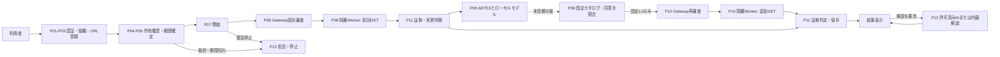
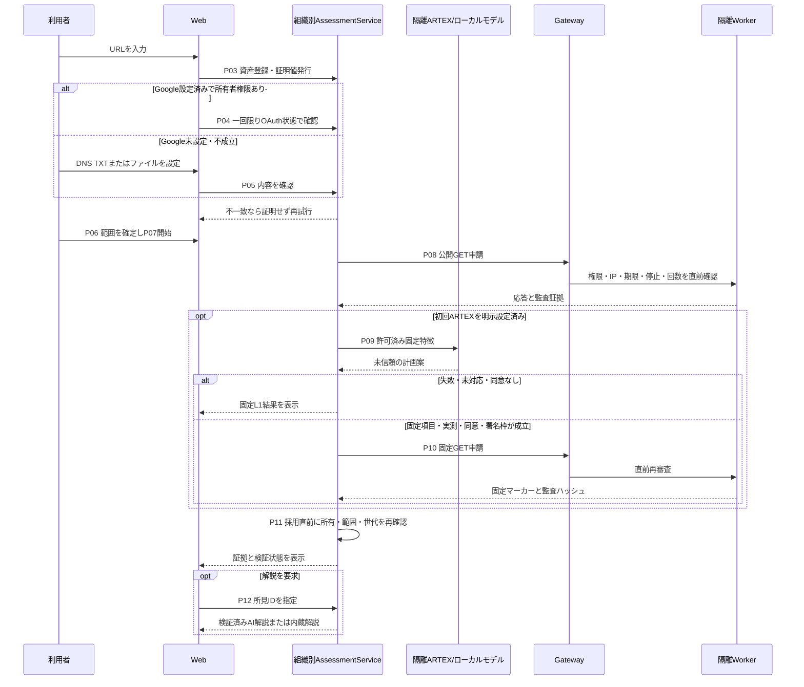
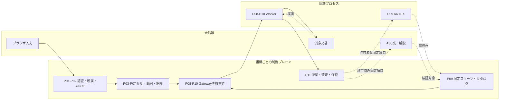
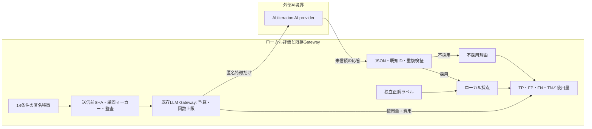

# 現行開発コードの処理系統

この文書はDraft PR #53〜#74と本ブランチを依存順に重ねた開発コードの経路を示す。公開βへ反映済みという意味ではない。APIと関数の基礎的な静的列挙は[PROCESS_INVENTORY.json](PROCESS_INVENTORY.json)、履歴と重複候補は[PROCESS_AUDIT.md](PROCESS_AUDIT.md)、同一ラボ測定は[STATUS_EXPOSURE_INTEGRATION.md](STATUS_EXPOSURE_INTEGRATION.md)。後続の検査選択評価は[ACCESS_CONTROL_BLIND_LAB.md](ACCESS_CONTROL_BLIND_LAB.md)、HTTP 200認証拒否の再測定は[AUTH_RESPONSE_LAB.md](AUTH_RESPONSE_LAB.md)、Cookie用途の再測定は[COOKIE_PURPOSE_LAB.md](COOKIE_PURPOSE_LAB.md)に分離した。静的列挙は後続PRのスクリプトまで網羅せず、動的URLや実行時設定も解決できないため、P17〜P23をコードと照合して追記した。

この累積コードとmainは異なる。PR #63以降はDraft・未マージで、#68の実Abliteration AI評価は鍵がないため未実行。公開βの実DNS所有確認・実サイト診断も未実証。以下の動作証拠は、明記がなければ隔離した模擬対象による。

## 構成

公開βの操作は「URL入力→所有確認→診断開始→結果表示」。Google所有確認は設定時だけ表示し、未設定ならDNS TXTまたはファイル方式を使う。URL登録では診断通信をしない。追加の`/server-status?auto` GETは設定、明示同意、署名付き範囲と診断枠、Apache系の初回実測、ARTEXの固定カタログ案がすべて揃った場合だけ実行する。実サイトL2は禁止。

## 操作・条件と発火する処理

表中のサーバールートは[`aegis/server.py`](../aegis/server.py)、`AssessmentService`の関数は[`aegis/assessment.py`](../aegis/assessment.py)、Gatewayは[`aegis/gateway.py`](../aegis/gateway.py)、隔離Workerは[`aegis/runtime.py`](../aegis/runtime.py)と[`aegis/workers`](../aegis/workers)、ARTEX変換は[`aegis/artex_bridge.py`](../aegis/artex_bridge.py)、画面は[`web/src`](../web/src)にある。機械抽出JSONにはファイルと行番号が入っている。

| ID | APIまたは条件 | 主な関数 | 主なテスト・通信 |
|---|---|---|---|
| P01 | `POST /api/auth/register`, `POST /api/auth/login`、MFA等 | `server.py` `_register`, `_login`, `do_POST`、`SessionProvider` | `test_server.py`, `test_tenancy.py`。Host・Origin・CSRF・セッション |
| P02 | `/api/orgs/*` | `_bind`, `_get_org`, `_dispatch`, `TenantRegistry.service` | `test_tenancy.py`。組織別のサービスへ限定 |
| P03 | `/api/assets/challenge` | `OwnershipWizard.issue` → `issue_ownership_challenge` | `test_real_service.py`。資産・証明値保存。対象通信なし |
| P04 | Google設定時 `/api/assets/google/start`, `/finish` | `google_ownership.py` → `verify_asset_ownership` | `test_tenancy.py`。Google OAuth / Search Console。公開βでは未設定 |
| P05 | `/api/assets/verify-ownership` | `OwnershipWizard.verify` → `verify_asset_ownership` | `test_real_service.py`。DNS照会または確認ファイルGET。不一致なら証明しない |
| P06 | `/api/assets/confirm-scope` | `OwnershipWizard.confirmScope` → `confirm_asset_scope` | `test_authority_ledger.py`。所有、承認者、対象、期限、追加GET同意を署名付き記録へ |
| P07 | `POST /api/assessments/{id}/{start,pause,resume,restart}` | `AssessmentService.start`, `_run`, `_run_inner` | `test_real_service.py`, `test_server.py`。世代・起動枠を確認 |
| P08 | 初回の安全なGET | `_run_inner` → `_plan` → `_exec` → `Gateway.execute` → `WorkerPool.run` | `test_gateway.py`。所有・範囲・IP・期限・停止・回数を直前審査 |
| P09 | 初回自動計画、または`POST /api/assessments/{id}/artex/plan` | `_plan_with_artex` → `anonymous_real_site_request` → `run_artex_planner` → `reconstruct` → `ProposalRouter` | `test_artex_bridge.py`、Linuxの実ARTEXジョブ、`scripts/bench_browser_owned_flow.py --real-artex --chromium`。固定特徴だけ送信、失敗時は固定L1のみ。モデル名は実転送確認時だけ表示 |
| P10 | 同意済み追加GET、または`POST /api/assessments/{id}/artex/items/{item}/execute` | `execute_artex_item` → 固定カタログ → `_exec` → `Gateway` → `WorkerPool` | `test_status_exposure_lab.py`, `test_gateway.py`。固定L1のみ、実サイトL2拒否 |
| P11 | `GET /api/assessments/{id}`, `GET .../logs`, `GET .../events`, `GET .../report` | `_analyze`, `_record_status_result_locked`, `analyze_status_marker_report`, `snapshot` | `test_real_service.py`, `test_status_exposure_lab.py`。証拠と監査ハッシュから`detected`。案のみは`candidate` |
| P12 | `POST /api/assessments/{id}/chat` | `ask_chat` → `_safe_real_ai_explanation` または `_answer_question` | `test_ai_advisor.py`。固定項目だけ送信、応答検証、不採用なら内蔵解説 |
| P13 | 停止・取消・期限切れ | `emergency_stop`, `_expiry_watch`, `_launch_guard`、Gateway起動世代 | `test_gateway.py`, `test_authority_ledger.py`。失効後の起動と結果採用を拒否 |
| P14 | `/api/system/verify-controls`, `/api/cve/*`, `/api/router/*` | `server.py` `JOB_ROUTES`, `control_verification.py`, `cve.py` | `test_cve.py`, `test_server.py`。通常診断から独立 |
| P15 | SSE心拍と静穏時の代替取得 | `useAssessment`、`polling.ts`、`server.py` `_sse_loop` | `web/tests/polling.test.mjs`, `test_server.py`。通し番号付き心拍で正常時の重複取得を抑え、欠落・切断時はsnapshotと監査ログへ収束。正常な心拍でも30秒ごとに正式な状態を再取得 |
| P16 | 画面内通知・承認待ち | `EventBus.publish`/`wait`, `_sse_loop`, `_decide` | `test_server.py`。メール・Webhook送信は見つからない |
| P17 | 14条件の実モデル選択評価（診断APIとは独立） | `scripts/eval_selection_model.py` `run_preview`, `run_approved` → 既存LLM Gateway | `test_selection_model_eval.py`。固定SHA・1回・US$0.01予算・2,000トークン、出力検証。鍵がなく実モデル未実行。対象GET・Worker起動なし |
| P18 | 認証・アクセス制御の模擬検証 | 初回GET → `analyze_l1_service_response`、観測リンク → ARTEX計画 → `execute_artex_item` → Gateway・Worker | `test_access_control_lab.py`, `bench_access_control.py`。14条件の独立正解、実ARTEX＋ローカル模擬モデルで選択精度を比較。IDORの再現は模擬対象限定 |
| P19 | IDOR・CORSの結果表示と競合制御 | `idorEvidence.ts`、`FindingLearningCard`、`FindingCard`、`useAssessment`、`polling.ts` | Webユニットテストと390px模擬ブラウザ。IDORの取得断定には対照証拠とbackend `proven` が必要。古い401/403で新しい画面を消さない |
| P20 | HTTP 200の認証拒否JSON | `analyze_l1_service_response` → `_auth_error_only` | `test_auth_response_lab.py`。6条件でGateway/Worker各6回、対象GET6回。本文全体と限定した拒否文言が確認できた場合だけ`candidate`へ下げる |
| P21 | Cookie用途と応答属性の照合 | 管理者承認済みサイトプロファイル `cookie_policy` → `_analyze` → `analyze_l1_service_response` | `test_cookie_purpose_lab.py`, `bench_cookie_purpose.py`。独立10条件の1分類。用途不明は`candidate`、既知の一般用途はセッション所見にしない。新しい対象通信なし |
| P22 | 混在Cookieの個別表示とHTTPS実測 | `analyze_l1_service_response` → `cookie_checks` → `FindingCard`/詳細画面。ローカルHTTPSサーバー→Chromium | `test_cookie_purpose_lab.py`, `cookieChecks.test.mjs`, `check_cookie_ui_390.py`, `check_cookie_https.py`。認証用・一般用途・用途不明を別表示し、Cookie値は表示しない。HTTPS6条件でブラウザ属性と判定を照合。対象通信はループバックだけ |
| P23 | 5分類の独立ラボ採点 | 既存のCORS・Cookie・認証/IDOR・ApacheラボJSON → `bench_multiclass.py` → 分類別指標とMacro平均 | `test_multiclass_macro.py`, `MULTICLASS_BLIND_LAB.md`。比較不能な分類はARTEX欄を空欄とし、Precision未定義を除外して分母を記録。CIでは既存の実ARTEX測定JSONを再利用 |
| P24 | 修正後のCORS・Cookie再確認 | `verify_fix` → `_verify_fix_body` → 初回と同じ `analyze_l1_service_response` → 証拠付き比較 | `test_cors_policy_lab.py`, `test_cookie_purpose_lab.py`。公開ワイルドカードや一般Cookieを再検出せず、用途不明は`candidate`。対象への再GETはGateway・Workerと既存権限の確認を通る。公開βの読み取り専用実サイトでは実行不可 |
| P25 | 初期観測後の追加検査省略 | `_run_inner` → `safe_public_fingerprint` → 署名済み追加GET同意・根拠確認 → `artex.initial_skipped` またはP09/P10 | `test_real_service.py`, `test_status_exposure_lab.py`, `bench_initial_extra_selection.py`, `INITIAL_EXTRA_SELECTION.md`。現行実サイトカタログの追加L1はApache `mod_status`だけ。CORS・Cookieの15条件で無駄な計画を削減。AI自身の判断力の証明ではない |
| P26 | 初期計画のカタログ変更検知 | P25 → `initial_real_site_extra_checks` → 未審査の追加L1があれば `artex.initial_fallback`、固定L1を継続 | `test_initial_extra_catalog.py`, `test_real_service.py`。カタログの全追加L1を明示分類するテストが、新項目追加時の安全性レビュー漏れを検出する |
| P27 | 既存分類と追加検査の混合条件評価 | 保留用正解表 → ローカルHTTPS対象 → P25/P26 → P09/P10 → 分類別の検出・選択採点 | `bench_initial_mixed_holdout.py`, `test_initial_mixed_holdout.py`, `INITIAL_MIXED_HOLDOUT.md`。CORS・Cookieの5組合せで固定・一律・観測選択を比較。実AIの推論精度は未評価 |
| P28 | Apache情報露出の選択と検出を分離 | 独立正解表 → 所有確認済みローカルHTTPS → P25/P26 → Gateway・Worker → 状態別採点 | `bench_status_selection_holdout.py`, `test_status_selection_holdout.py`, `STATUS_SELECTION_HOLDOUT.md`。同意なし条件は追加GETを行わず、脆弱性検出精度の分母から除外する |
| P29 | 5分類の保留用条件を横断比較 | CORS/Cookie・Apache・認証/IDORの独立対象 → 分類別TP/FP/FN/TN → Macro・選択精度・通信費用 | `bench_access_holdout.py`, `bench_five_class_holdout.py`, `test_access_holdout.py`, `FIVE_CLASS_HOLDOUT.md`。認証とIDORが共有する対象GETは一度だけ数え、実AIの精度と混同しない |
| P30 | 初期観測事実から単回で検査選択 | P09の初期グラフ要約 → 事実が十分なら直接意図提案、足りなければ `list_facts` → P10のGateway審査 | `vulnix_bridge.go`, `artex_mock_llm.py`, `bench_first_prompt_selection.py`, `FIRST_PROMPT_SELECTION.md`。既存の事実表示を再利用し、事実不足時の参照手段は維持する。実モデルが省略するかは未測定 |
| P31 | 未知のLink表記を隔離ラボで比較 | 独立したLink応答・所有者仕様・正解表 → 初期観測 → P30/P09 → Gateway・隔離Worker → 選択と実証を別採点 | `access_link_holdout_lab.py`, `bench_access_link_holdout.py`, `test_access_link_holdout.py`, `ACCESS_LINK_HOLDOUT.md`。Lab専用の関係解析を拡張し、実サイトL2禁止は維持する |
| P32 | Apache観測事実の再取得を比較 | 初期の匿名化指紋 → ARTEXの初回要約または `list_facts` → P10の審査・隔離Worker | `bench_status_first_prompt.py`, `test_status_selection_holdout.py`, `STATUS_FIRST_PROMPT.md`。同じ同意・露出条件で選択・証拠・通信・モデル要求を比較し、実AIの判断とは区別する |

## 時系列と異常系

ARTEX中・Worker中の停止、所有取消、期限切れ、IP変更はP13が新規起動または結果採用を拒否する。再試行時も再審査する。SSE切断はP15の取得で補う。監査失敗時は新しい計画・実行候補を有効化しない。再起動後は計画元の表示だけ復元し、実行可能項目は復元しない。

P17は診断フローの外にある固定入力の評価であり、モデル出力をP10の実行へ接続しない。P18のIDOR `proven` は所有者側の対照GETと別アカウントからのGETを要し、実サイトL2では実行しない。P19の表示はバックエンド判定を超えた脆弱性の断定をしない。P20の6条件は独立した追加測定であり、P17の承認済み14条件の入力ハッシュに含めない。

P21は初回GETに含まれる`Set-Cookie`だけを評価し、追加GETを発生させない。サイトプロファイルの内容が変わった場合は従来の管理者によるハッシュ承認が必要で、未承認の用途情報は検出判定に使わない。Cookie名・属性・所有者仕様をARTEXや外部AIへ追加送信しない。

P24は再GETの観測を初回と同じ判定器へ渡す。P25はP09の起動前に追加検査の適用可能性と同意を確認するだけであり、実行直前のGatewayによる再審査を省かない。現行カタログで有益な追加L1がない場合はモデルを起動せず、初回所見と監査を残す。P26は新しい追加L1がP25の省略条件を黙って継承しないよう検知する。P27は複数の既存所見とApache追加検査を同時に持つ条件で、省略と必要検査の見逃しを別々に測る。

| 外部通信先 | 発生条件・境界 |
|---|---|
| DNSまたは対象の確認ファイル | P05の所有確認操作時。診断用通信とは区別 |
| Google OAuth / Search Console API | P04が設定済みで選択された場合だけ。現在の公開βでは未設定 |
| 所有確認済み対象または`lab.test` | P08の初回GET、条件成立時だけP10の追加GET。必ずGateway・隔離Worker経由 |
| ARTEXのモデル上流 | P09のローカルLLM Gateway経由。実サイトでは許可済みの構造化特徴だけ |
| Abliteration AI | P12の明示設定・解説要求時だけ。固定項目の送信と応答検証が必要。公開βでは無効 |

`/api/cve/sync`は提供された資料の取り込みで、通常診断で外部URLを取得しない。`FeedMonitor.sync_from_urls`はテスト以外の呼び出しが見つからず、運用上の用途は未確認。外部モデル上流や資料URLは設定・引数から決まるため、静的文字列の列挙だけでは確定しない。

## 信頼境界

AIにはホスト名、URL、認証情報、個人情報、応答本文、秘密情報を無断送信しない。ARTEXにWorker起動権限はない。Gatewayの実行直前審査は時間差・失効・DNS/IP変化・停止競合に必要なため削らない。

P17の実モデル評価は診断経路と切り離している。

正解ラベルはモデル入力へ入れず、評価応答から診断・Worker起動へ向かう辺もない。モデル未実行のため、現時点の実モデル指標は空欄である。

## 最適化の実測と残件

独立した3モードの`mod_status`ラボでは、固定L1がTP0/FP0/FN1/TN2、実ARTEX計画と同意済み追加GETがTP1/FP0/FN0/TN2。Precisionは前者が未定義、後者が100%、Recallは0%→100%、誤検知率は両方0%。同条件でGateway/Worker/対象GETは各1→2、状態保存15→17、署名台帳commit17→21、完了時間も増加。Planner Gatewayの8,328トークンは予算用推定値で、実使用量・請求額ではない。[測定資料](STATUS_EXPOSURE_INTEGRATION.md)に各モードの値がある。速度・費用改善は証明できていない。

| 指標 | 固定L1 | 実ARTEX・ローカル模擬モデル | 測定範囲 |
|---|---:|---:|---|
| 診断完了時間 | 0.107 / 0.204 / 0.107秒 | 1.368 / 1.220 / 1.321秒 | 脆弱・修正済み・紛らわしい200の各1回 |
| Gateway / Worker / 対象GET | 各1回 | 各2回 | 各モード |
| 状態保存 / 署名台帳commit | 15 / 17回 | 17 / 21回 | JSON・台帳への書き込み。SQL DBアクセスではない |
| LLM呼び出し / 予算用推定トークン | 0 / 0 | 2回 / 8,328 | ローカル模擬モデル。実トークン数は未計測 |
| 商用モデルの推定・実費用 | 未算定 / 0 | 未算定 / 0 | 有料APIを呼んでいない |
| TP / FP / FN / TN | 0 / 0 / 1 / 2 | 1 / 0 / 0 / 2 | 独立3モードの固定ラベル |
| 期限切れ・所有取消の拒否 | 2/2 | 2/2 | この2条件のみ。全安全制御の成功率ではない |

390px幅の本番ビルド通し測定は代役プランナーに加え、Linux CIで**ピン留めした実ARTEXとローカル模擬モデル**でも実行した。実ARTEXの単発測定はブラウザAPI要求12回、ログイン後の操作8回、模擬モデル2回、対象GET2回、診断開始から所見表示まで1.771秒。[測定資料](STATUS_EXPOSURE_INTEGRATION.md)。

ログイン画面の重複した`/api/auth/me`取得と監査ログの同一ファイル二度読みは削減済み。P15は正常なSSE心拍の間だけ静穏時の重複取得を抑え、24秒の同一模擬条件で待機時API要求12→6回だった。使途未確認の`FeedMonitor.sync_from_urls`は未変更。外部AI解説のドル建て予算予約は後続Draft PRのコードで実装したが、運用料金の妥当性と実請求額は未照合。390px幅の一連操作は実ARTEXを含む[模擬環境の通し測定](STATUS_EXPOSURE_INTEGRATION.md)を行った。公開βの所有確認→実サイト診断→結果表示、実Abliteration AIの採用可能な日本語解説、実サイト全般の精度は未確認または未完成。公開βで開発ブランチの機能が動いていると扱わない。

## 次の変更順序

1. P12の外部AI費用上限はDraft PRで送信前の最悪値予約・同時要求・再起動後の累計を実装した。独立レビュー、料金設定と実請求額の照合を経るまで公開βでは有効にしない。
2. P15は正常なSSEで待機時API要求を削減し、APIが応答する限り30秒を超えた次の正式な状態再取得で未発行イベントによる無期限の古さを防ぐ。Cloudflare等の中継を挟んだ監査ログの鮮度と失効通知の遅れは別途測る。停止・取消が画面に届く保証は維持する。
3. 同一の独立ラボでブラウザのURL登録から結果表示までを390px幅で通し、実ARTEXとローカル模擬モデルでも所見・出所表示・ホスト名とURLの非送信を確認した。公開βの実DNS・組織設定・中継を含む動作確認は残る。
4. P09/P12の採用率・実トークン・費用と公開βの実サイト経路は、必要な承認と所有確認を得た後に別途検証する。実サイトL2は引き続き禁止する。
5. P17の承認済み1回は固定要求のハッシュ、費用上限、鍵、二重送信防止を送信直前に照合する。鍵が利用できない間は実Abliteration AIのJSON採用率・TP/FP/FN/TN・実費用を未測定とし、固定規則の成績を実モデル性能に流用しない。
6. P18の14条件では、ローカル模擬モデルで一律提案から観測選択へ移ると不要な検査が6→1件、対象GETが34→29回だった一方、実ARTEX経路の推定トークンは104,174→139,338へ増加した。実AIの選択能力・複数分類の精度には一般化しない。P20の6条件はHTTP 200認証拒否によるFPを3→0件に減らしたが、ARTEX選択や実サイトの診断範囲は増やしていない。
7. P21のCookie用途10条件は固定L1のTP/FP/FN/TNが3/4/1/2、所有者仕様を用いた修正後は4/0/0/6だった。これも1分類の小さなラボであり、実HTTPSのWorker経路・ARTEX選択・実サイト精度は残る。
8. P22では混在Cookieを個別に保持し、390pxのChromiumで画面部品の表示を確認した。ループバックHTTPS6条件でも属性保存・`document.cookie`と診断判定の一致を確認した。公開βの画面通し操作や実HTTPSのGateway/Worker経路は残る。
9. P23では5分類を同じTP/FP/FN/TN定義で採点し、分類ごとの条件数とMacro平均の分母を示す。CORS・CookieのARTEX欄は未評価のまま保ち、実ARTEX+模擬モデルと実Abliteration AIを混同しない。
10. P24は修正後再確認で初回診断より弱いCORS・Cookie基準を使っていた回帰を修正した。P25はCORS・CookieのローカルHTTPS15条件で一律ARTEXの不要な提案15件・計画起動15回を省いた。対象GETとWorker起動は15回のまま、判定一致も15/15を維持した。実ARTEXとローカル模擬モデルの代表条件はLinux CIで別途測る。
