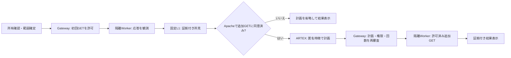

# 初期観測後の追加検査選択（隔離ラボ）

## 対象と境界

この測定は、所有確認を模擬したローカル HTTPS の CORS 5 条件と Cookie 10 条件を対象とする。Cookie の正解ラベルと所有者仕様は、診断器から独立した `tests/fixtures/cookie_purpose_truth.json` と `tests/fixtures/cookie_owner_specs.json` に置く。CORS の条件は独立した模擬サーバーが返す応答に基づく。各条件について固定診断、一律 ARTEX 計画、初期観測による計画省略を同じ応答で比較した。実サイトや有料モデルには通信していない。

現行の実サイト初期計画で、最初の GET 以外に実行できるカタログ項目は Apache `mod_status` の固定マーカー確認のみである。サーバーが Apache でない、または追加 GET の署名済み同意がない場合、Gateway で実行できる追加検査がない。省略判定はこの安全なカタログと診断権限に基づく。追加の L1 カタログ項目が未審査のまま増えた場合は、初期計画を安全側で省略し、監査に `unreviewed_extra_catalog` を記録する。手動のARTEX計画でも未審査項目は実行直前に拒否する。カタログ全件の明示的分類を要求する回帰テストも失敗するため、新項目の適用条件・Gateway 権限・実行経路を同時にレビューする必要がある。**AI 自身が CORS や Cookie の意味を理解して「省略」を選んだ証拠ではない。** Apache の場合は従来どおり ARTEX が計画し、Gateway と隔離 Worker が追加検査を制御する。

## 同一条件での測定

macOS、ARTEX 互換のローカル模擬プロセス、ローカル HTTPS、15 条件。診断時間は各条件の診断開始から結果取得までの合計であり、所有確認の準備時間は含まない。

| 方式 | 正解ラベル一致 | 追加検査提案 FP / TN | 対象 GET | Worker 起動 | 計画起動 | 時間合計 |
| --- | ---: | ---: | ---: | ---: | ---: | ---: |
| 固定 L1 | 15/15 | 0 / 15 | 15 | 15 | 0 | 1.408 秒 |
| 一律 ARTEX 提案 | 15/15 | 15 / 0 | 15 | 15 | 15 | 9.675 秒 |
| 観測後に省略 | 15/15 | 0 / 15 | 15 | 15 | 0 | 1.498 秒 |

一律提案は全 15 件で不要な Apache 検査を提案したが、Gateway によって実行はされていない。観測後の省略はその 15 件の計画起動を減らし、診断結果と対象通信回数を変えなかった。全方式で診断開始から結果確定までを計測し、一律計画も初回観測直後、結果確定前に実行した。条件順に実行した値であり、処理時間の差を一般サイトや別のマシンへ外挿しない。CORS・Cookie の追加検査選択には正例がないため、選択 Recall は未定義とする。検出の TP/FP/FN/TN は合計 5/0/0/10 で、候補は検出済みに数えない。

模擬プロセスは LLM を呼ばないため、ここでモデルのトークン・料金は測れない。Linux CI では代表 2 条件を実 ARTEX とローカル規則型モデルで実行し、モデル呼び出し・推定トークン・推定費用を別の証拠ファイルに記録する。推定料金は有料 API の請求実績ではない。

## 5 分類の比較で分けるべきこと

- CORS・Cookie: 初回 GET で所見が判定でき、現行カタログに有益な追加 L1 検査がないため、ARTEX 起動を省略する。
- 認証必須 JSON: 所有者仕様と初回 GET による判定は固定 L1 が担当する。ARTEX の改善として数えない。
- IDOR: 隔離ラボ内で観測リンクに応じて ARTEX が検査を選び、Gateway と Worker で対照実行する。実サイト L2 は引き続き禁止。
- Apache 情報露出: Apache の初期観測と追加 GET の同意がある場合のみ、ARTEX が `mod_status` を計画できる。署名済み範囲、通信回数、停止は Gateway が再検証する。

この 5 分類に共通の実 AI 選択精度はまだ測定できていない。実 Abliteration AI の回答採用率・診断品質、未知条件での選択、公開 β の実 DNS と実サイト E2E、独立した正式レビューは未完了であり、公開判定は保留する。

再現: `VULNIX_NO_ENV_LOCAL=1 python3 -m scripts.bench_initial_extra_selection`。CI の代表条件は `--smoke` を付ける。
