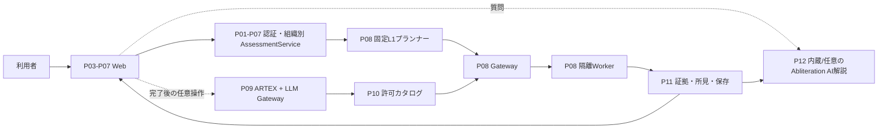
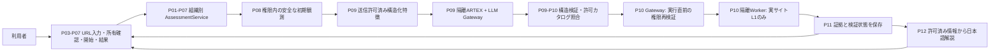
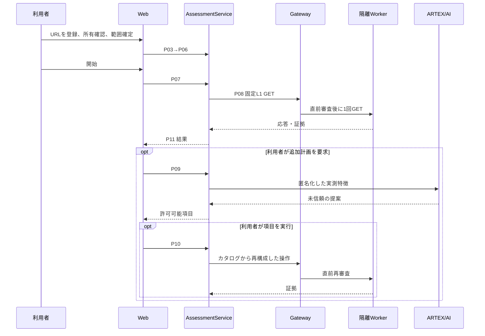
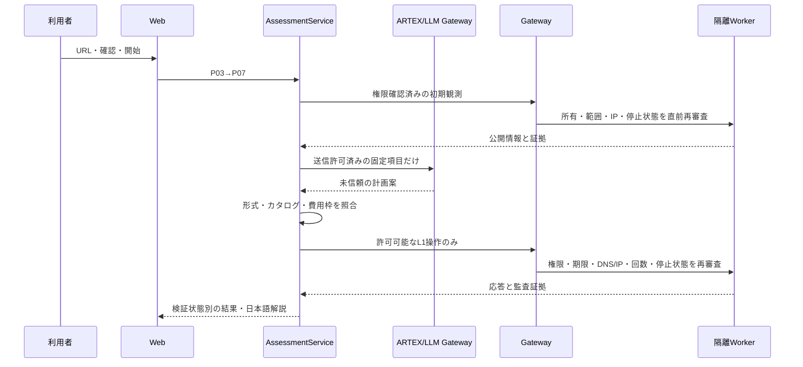
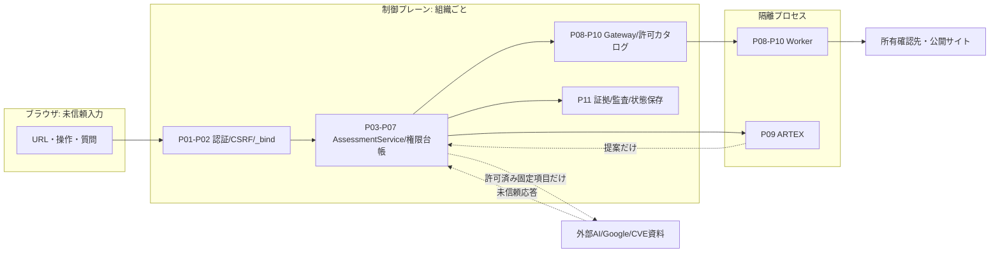
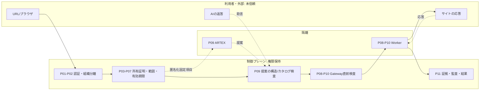

# 処理系統監査と段階的な最適化

対象: `codex/process-chain-optimization`。起点は [REQUEST_FLOW.md](REQUEST_FLOW.md)。実コードの機械抽出結果は [PROCESS_INVENTORY.json](PROCESS_INVENTORY.json)、再生成は `python3 scripts/flow_inventory.py > docs/PROCESS_INVENTORY.json`。この抽出は**ソースの条件式・定義・呼び出し箇所の一覧**であり、動的に構成するパスと環境変数の実行先をすべて解決した呼び出しグラフではない。以下の手動追跡と組み合わせて読む。

## 調査の範囲と漏れ

機械抽出ではバックエンド関数774、Web関数197、ARTEX overlayのGo関数27、API分岐条件75、通信・プロセス起動箇所23、バックグラウンド起動箇所26、WebのAPI参照62を列挙した。`REQUEST_FLOW.md` に文字列として現れない固定APIパスは29件、動的な評価式は6件あった。未記載は主にアカウント/MFA/組織招待、資産削除・選択、CVE同期、全体の制御検証、監査ログ・イベント・レポート出力である。これらを「未使用」とみなして削除してはいけない。URLを構成する経路（例: `/api/assessments/{id}/...`）は機械抽出だけでは網羅判定できない。

| ID | 利用者・内部操作 → API | 主なコード | 主要テスト・状態 |
|---|---|---|---|
| P01 | 登録・ログイン・ログアウト、MFA・パスワード → `/api/auth/*` | `server.py` `do_POST` / `_register` / `_login`、`operators.py`、`SessionProvider` | `test_server.py`, `test_tenancy.py`; ログイン画面の重複取得を本PRで削減 |
| P02 | 組織選択・招待・権限変更 → `/api/orgs/*`, `/api/invites/accept` | `server.py` `_tenancy_get` / `_tenancy_post` / `_bind`、`tenancy.py` `TenantRegistry.service` | `test_tenancy.py`; 他組織のサービスに触れない |
| P03 | URL登録 → `/api/assets/challenge` | `OwnershipWizard.issue`, `server.py` `_dispatch`, `AssessmentService.issue_ownership_challenge` | `test_real_service.py`, `test_tenancy.py`; 登録時は対象通信なし |
| P04 | Google所有確認 → `/api/assets/google/start`, `/finish` | `google_ownership.py`、`server.py`、`AssessmentService.verify_asset_ownership` | `test_tenancy.py`; 公開βでは未設定。OAuth状態は短命・一回限り |
| P05 | DNS TXT/ファイル確認 → `/api/assets/verify-ownership` | `ownership.py`、`AssessmentService.verify_asset_ownership` | `test_real_service.py`, `test_tenancy.py`; 不一致・再確認失敗で拒否/取消 |
| P06 | 範囲確定 → `/api/assets/confirm-scope` | `OwnershipWizard.confirmScope`、`AssessmentService.confirm_asset_scope`、権限台帳 | `test_real_service.py`, `test_authority_ledger.py`; ホスト・ポート・期限を保存 |
| P07 | 初回開始/中断/再開/再診断 → `/api/assessments/{id}/{start,pause,resume,restart}` | `server.py` `_dispatch`、`AssessmentService.start` / `_run_inner` | `test_real_service.py`, `test_server.py`; 状態と世代を検査 |
| P08 | 初回の安全な観測と固定L1計画 | `_run_inner` → `_plan` → `_exec` → `Gateway.execute` → `WorkerPool.run` | `test_real_service.py`, `test_gateway.py`; 公開GETを1回、L2なし |
| P09 | ARTEX追加計画 → `/artex/plan`, `/artex/llm-preview`, 承認API | `plan_with_artex`、`artex_bridge.py`、`planner_llm_gateway.py`、`router.py` | `test_artex_bridge.py`; 現行は初回L1完了後の任意操作 |
| P10 | ARTEX項目の確認 → `/artex/items/{item}/execute` | `execute_artex_item` → カタログ再構成 → `_exec` → Gateway → Worker | `test_artex_bridge.py`, `test_gateway.py`; 実サイトは読み取り専用L1だけ |
| P11 | 証拠・判定・保存 → `/api/assessments/{id}`, `/logs`, `/events`, `/report`, `/remotion` | `_analyze`, `service_diag.py`, `evidence.py`, `snapshot`, `audit.py`, `EventBus` | `test_real_service.py`, `test_server.py`; candidate/detected/provenを分離 |
| P12 | 日本語解説 → `/chat` | `ask_chat`, `_safe_real_ai_explanation`, `ai_advisor.py`, 内蔵説明 | `test_ai_advisor.py`; 実サイトの外部AI経路は公開βで無効、実モデル採用率未確認 |
| P13 | 緊急停止・取消・期限切れ | `/emergency-stop`, `/api/assets/delete`, `_expiry_watch`, `_authority_reduced_locked`, Gateway起動世代 | `test_gateway.py`, `test_authority_ledger.py`; 保留中・実行中の権限を失効 |
| P14 | CVE資料・制御自己検証 → `/api/cve/*`, `/api/system/verify-controls`, `/api/router/verify` | `cve.py`, `control_verification.py`, `server.py` `JOB_ROUTES` | `test_cve.py`, `test_server.py`; 診断の通常経路から独立 |
| P15 | UIのセッション・進捗通信 | `SessionProvider.refresh`, `useAssessment.refetch` / SSE / 4秒バックアップ | `web/tests/polling.test.mjs`; 受信が静かな間はsnapshotと全監査ログを定期取得 |
| P16 | 画面内通知・承認待ちの再開 | `EventBus.publish` / `wait`、`server.py` `_sse_loop`、`AssessmentService._decide` | `test_server.py`; 画面へのSSE。メール・Webhook送信経路は見つからない |

外部通信先は、P05のDNS照会または対象ホストの確認用ファイル、P04のGoogle OAuth/Search Console API、P08/P10の所有確認済み対象または`lab.test`、P09の許可済みLLM上流（隔離ARTEXはローカルGatewayだけに接続）、P12の明示設定されたAbliteration AI APIである。P14の`/api/cve/sync`はリクエストに含む資料を取り込む処理で、外部へ取得しに行かない。`cve.py`には別途`sync_from_urls`があるが、通常のAPI経路への接続は確認できなかった。LLM上流と任意の資料URLは設定・引数から決まるため、固定文字列の機械抽出だけでは確定しない。これらは別々の権限・費用・送信情報の境界として扱う。

## 現状と目標の構成

目標図は**設計案**であり現行実装ではない。初期観測の対象通信も所有確認・範囲確定後に限る。ARTEXの提案からWorkerを直接起動する経路は設けない。AIが失敗/不採用なら固定L1と内蔵解説へ戻し、診断をAIの可用性に依存させない。実サイトL2は全経路で禁止を維持する。

## 現状と目標の時系列

## 信頼境界

両図とも外部AI/ARTEX/サイト応答は信頼しない。ホスト名、URL、認証情報、個人情報、応答本文、秘密情報を外部AIへ無断送信しない。Gatewayの二度目の検査はTOCTOU対策であり重複として削除しない。

## 異常・再試行・競合の確認点

| 場面 | 現在の処理 | 最適化時に守る不変条件 |
|---|---|---|
| 未ログイン/他組織/失効セッション | `do_GET`/`do_POST`→`_bind`、SSEも再照会して終了 | 他組織のsnapshot、監査、証拠に到達しない |
| 所有確認失敗/再確認失敗 | 証明を記録せず、既存権限は取消し得る | 表示フラグだけで開始しない |
| 範囲期限・DNS/IP変化 | `_expiry_watch`、実行直前Gateway、結果採用直前の権限再照会 | 保留中の操作を起動せず、失効後の結果を採用しない |
| 同時実行/停止 | 世代番号・Gateway launch epoch・Worker停止確認 | 停止未確認なら新規起動拒否、旧世代の結果破棄 |
| ARTEX/LLM失敗・未対応提案 | 計画失敗を監査、未対応案は助言扱い | AI生出力や引数をそのままWorkerへ渡さない |
| SSE断/遅延 | スナップショットと全ログの定期再取得 | 進捗と監査チェーンの収束を保つ |
| 保存失敗 | 実サイト送信前に状態保存可否を確認 | 監査不能な送信をしない |

## 重複・未使用・未検証

| 区分 | 実コードからの所見 | 判断 |
|---|---|---|
| 重複 P01/P15 | ログイン画面と`SessionProvider`が同じ`/api/auth/me`を取得 | 本PRで共通の取得結果を利用。権限判定はサーバー側のまま |
| 重複候補 P08/P09 | 固定L1 GETのあとに任意ARTEX計画。AIは初回診断に寄与しない | 初期観測は残し、その証拠でARTEXを一度だけ計画へ組み込む設計を独立レビューへ |
| 必須の再検証 P06/P08/P10 | 所有・範囲とGateway直前検査 | 時間差、DNS/IP変更、停止競合があるため維持 |
| 重複候補 P15 | 静かなSSEでは4秒ごとにsnapshotと全ログを再取得 | 監査チェーンの鮮度を下げずに回数を減らせるか別測定が必要 |
| 未使用と断定不可 | 管理・CVE・制御自己検証ルートは通常UIフローに現れない | 運用/安全機能なので使用実態の計測なしに削除不可 |
| 通常経路で未使用 P14 | `FeedMonitor.sync_from_urls` | 参照は`tests/test_cve.py`のみ。`/api/cve/sync`は`ingest_payloads`を呼ぶ。削除前に運用上の用途を確認 |
| 未検証 P04 | Google OAuthの公開β E2E | 設定なし。ボタンは非表示 |
| 未検証 P09/P12 | 実サイトでのARTEX計画、実Abliteration AIの採用可能な解説 | 公開βで無効。課金枠と送信内容の審査が必要 |
| 未検証 P07–P12 | 所有確認済み実サイトの公開β完走 | DNS設定と所有者操作がまだない。未承認の実通信はしない |

実サイト向け外部AI解説には、API回数と出力トークンの制限がある一方、ドル建ての強制上限はコード上で確認できなかった。モデル料金を仮定して「費用削減」と報告しない。実モデルを有効化する前に、送信許可情報・一回あたりの上限・合計予算・不採用時の課金を独立レビューする。

## 同一模擬条件での変更前後の測定

P01の模擬ブラウザ測定: ローカルNext.js開発サーバー、幅390px、`/api/auth/me`を固定応答（未ログイン・登録可・Google無効）で置換、Chrome headlessで`/login`を1回表示。Reactの開発時の再実行を含む。同じスクリプト・同じサーバーで測定。

| 指標 | 変更前 | 変更後 | 解釈 |
|---|---:|---:|---|
| `/api/auth/me`呼び出し | 4 | 2 | 50%減。開発モードでの実測。製品版の値とは区別 |
| 登録タブ表示 | 成功 | 成功 | 390pxで操作可 |
| ページ表示時間 | 0.751秒 | 0.718秒 | 変動の範囲。速度改善とは主張しない |
| AIトークン/費用、Worker、DB、脆弱性検出 | 0/0、0、未計測、対象外 | 同左 | この変更はログイン画面に限定 |
| ユーザー操作数 | 0 | 0 | 変化なし |
| サーバーの認証/組織安全制御 | 同じAPI・同じバックエンド | 同じ | 本修正では変更なし。全回帰テストで確認する |

**診断全体の前後比較は未完了。** 現在の固定L1と目標の初回ARTEX計画は、まだ同じ模擬対象で走る二つの実装になっていない。従って診断完了時間、AIトークン・推定費用、Worker起動、DBアクセス、検出数、偽陽性/見逃し、操作数、安全制御成功率について改善率を提示できない。次段階では脆弱・修正済みの同一ラボを使い、各指標の収集点をP07–P12に置く。料金表が確定しない限り推定費用は「未算定」とする。精度の現状値は `REQUEST_FLOW.md` のL1: TP3/FP0/FN2/TN2/未計測3で、AI追加後に低下しないことを独立ラボで確認する。

現行診断の模擬ベースラインも `python3 -m scripts.bench_lab_l1` で採取した（スクリプト内で外部モデルとローカル設定読み込みを無効化）。直近の脆弱ラボは0.083秒、修正済みラボは0.084秒。どちらもGateway 1回、Worker起動1回、外部モデル呼び出し0回、AIトークン0。状態保存メソッド呼び出しは脆弱ラボ19回、修正済みラボ16回だった。これは各1回の参考値であり、速度比較や改善率ではない。診断状態はJSONファイル保存なので、ここでSQLの「DBアクセス回数」を捏造しない。脆弱ラボの`detected`は3件、`candidate`は2件。修正済みラボの`detected`は0件、`candidate`は3件だった。安全制御の成功率はこのベンチマークでは測っておらず、既存の独立テストで確認する。

## 実装順序

1. 本PR: P01の重複通信を削減し、機械棚卸しと目標設計を固定。公開βへは未反映。
2. 次の小PR: P07–P12に模擬専用の計測を追加し、現行診断の時間・通信・モデル利用・Worker・保存・精度・安全性を採取。通常経路の制御は変えない。
3. 独立レビュー後: 初期観測をARTEXの入力に接続。未対応提案は候補として表示し、許可カタログ一致のL1だけGatewayへ渡す。AI失敗時は固定プランナーを使用。
4. 同一ラボで前後比較し、偽陽性増加・見逃し増加・停止/失効/組織境界の回帰がない場合に限って次段階へ進む。実サイト通信・有料AI・公開βへの反映は別途承認を取る。
