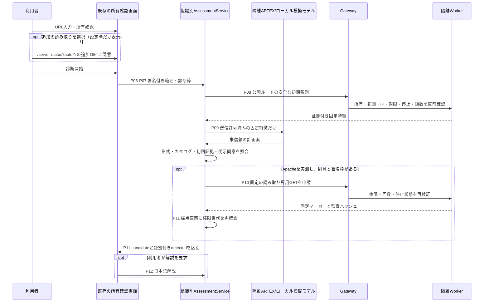
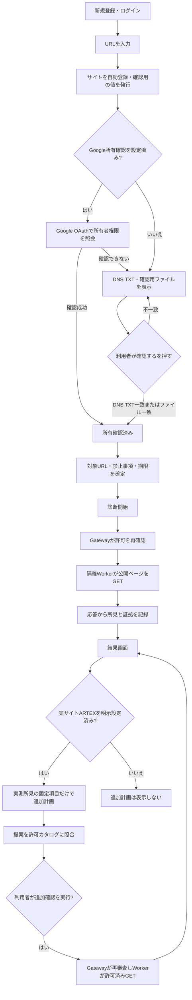
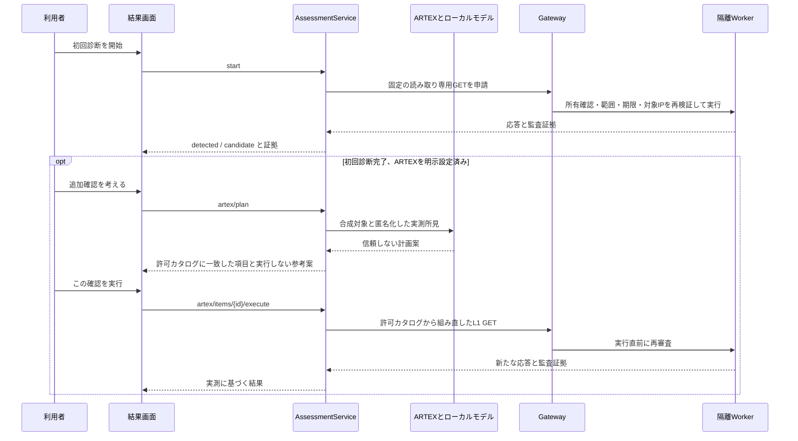

# Vulnix の操作・処理対応図

全ルートの機械棚卸し、異常系、現状/目標の図、実測値は [処理系統監査](PROCESS_AUDIT.md) を参照してください。

この資料は一般ユーザーの操作から結果表示までを追跡したものです。後続のDraft PR #53〜#55では、初回の安全なGETからARTEX計画を自動生成し、追加GETへの明示同意がある場合だけ固定の`/server-status?auto`をGateway・Workerへ渡す経路を実装した。直下の図が**Draft PRを重ねた現在のコード経路**。その次の「1〜3」の従来図と表は`codex/real-site-flow-map`時点の記録であり、初回ARTEXの接続を反映していない。実測は[初回ARTEX追加検査の測定](STATUS_EXPOSURE_INTEGRATION.md)を参照。**現在公開中のβ版**ではGoogle Search Console、実サイトARTEX、実サイト向け外部AI解説は未設定で、この追加経路は動作しない。

## 後続Draft PRの初回診断経路

ARTEXは計画だけを返し、Workerを直接起動できない。モデル失敗・未対応提案・同意なしでは固定の初期観測だけを残す。実サイトL2は禁止。3モードの独立ラボで、`mod_status`検出は変更前TP0/FP0/FN1/TN2、変更後の実ARTEX経路TP1/FP0/FN0/TN2だった。ただし追加GET・Worker・保存・時間は増え、一般の実サイトへの精度や速度の保証ではない。

## 1. ユーザー操作から診断結果まで

DNS方式の「確認する」はDNS照会、ファイル方式は登録サイトの確認用ファイルへのGETを行います。これらは所有確認のための通信です。**診断用GETは、所有確認と診断範囲の確定が済むまで行いません。** Google方式はGoogle APIに照会し、登録サイトへは通信しません。

## 2. 操作ごとに発火する関数

| 操作・条件 | 画面・API | 発火する主な処理 | 通信・保存・拒否条件 |
|---|---|---|---|
| 新規登録 | [`login/page.tsx`](../web/src/app/login/page.tsx) → `POST /api/auth/register` | [`server.py` の `_register`](../aegis/server.py) | アカウントと組織を作成。以後の組織ルートは `_bind` が所属と組織内権限を検証 |
| ログイン | 同画面 → `POST /api/auth/login` | [`server.py` の `_login`](../aegis/server.py) | セッションCookieを発行。POSTはHost、CSRFヘッダー、Origin、本文サイズを検査 |
| URL入力・送信 | [`OwnershipWizard.issue`](../web/src/components/OwnershipWizard.tsx) → `POST /api/assets/challenge` | `_dispatch` → [`AssessmentService.issue_ownership_challenge`](../aegis/assessment.py) → `parse_service_target` / `challenge_for_host` | 組織の資産とDNS TXT・ファイル用の値を保存。**この時点では対象サイトに通信しない**。既存の有効なGoogleドメイン証明が同じ組織にあればサブドメインへ引き継ぐ |
| Google未設定 | `GET /api/auth/me` の `google_ownership:false` | [`useSession`](../web/src/components/layout/SessionProvider.tsx) → `OwnershipWizard` | Googleボタンを隠し、DNS TXT・ファイル方式を表示 |
| Google設定済み | `POST /api/assets/google/start` → Google → [`verify/google/page.tsx`](../web/src/app/verify/google/page.tsx) → `POST /api/assets/google/finish` | `google_ownership.new_pkce` / `authorization_url` / `owned_sites` / `covering_property` → `verify_asset_ownership` | 短命・一回限りの状態をアカウント、組織、対象に紐付ける。所有者権限を確認した場合だけ証明を保存。失敗時はDNS・ファイル方式へ戻る。**公開βでは未設定・実OAuth未確認** |
| DNS TXTまたはファイル確認 | `OwnershipWizard.verify` → `POST /api/assets/verify-ownership` | [`verify_asset_ownership`](../aegis/assessment.py) → [`verify_ownership_challenge`](../aegis/ownership.py) | DNS TXTの完全一致、または確認用ファイルの内容を確認。署名付きの所有確認記録を保存。不一致なら診断不可。既存許可の再確認失敗時は許可を取り消す |
| 診断範囲の確定 | `OwnershipWizard.confirmScope` → `POST /api/assets/confirm-scope` | [`confirm_asset_scope`](../aegis/assessment.py) | 承認責任者権限、同一ホスト・スキーム・ポートの有効な証明、禁止事項への同意を確認。対象範囲と30日の期限を保存。所有確認の表示フラグだけでは通らない |
| 初回診断開始 | 同処理 → `POST /api/assessments/{id}/start` | [`AssessmentService.start`](../aegis/assessment.py) → `_run` → `_run_inner` | 有効な許可を確認して別スレッドで開始。実サイトは組織・全体の回数上限を適用 |
| 公開ページの読み取り | `_run_inner` → `_plan` → `_exec` | [`Gateway.execute`](../aegis/gateway.py) → [`WorkerPool.run`](../aegis/runtime.py) | 固定の読み取り専用GETを1回。Gatewayがトークン、承認、期限、対象、DNS固定先、通信回数の上限、停止状態を検証。隔離Workerだけが通信する |
| 所見・証拠の保存 | `_exec` → `_analyze` | [`analyze_l1_service_response`](../aegis/service_diag.py) → `_upsert_finding` | 実応答と監査ハッシュから判定。未実証の候補は `candidate`、実測で確認したものだけ `detected`。実サイトのL2は実行しない |
| 結果表示 | [`useAssessment`](../web/src/lib/useAssessment.ts) → [`AssessmentTabs`](../web/src/components/assessment/AssessmentTabs.tsx) | `GET /api/assessments/{id}`、`GET .../logs`、イベント受信、4秒間隔の代替再取得 | 組織の `AssessmentService.snapshot` と監査ログから表示。候補と検出、証拠、実際の診断元を区別 |
| AIによる追加計画（任意） | 診断完了後の [`ArtexPlanPanel`](../web/src/components/assessment/ArtexPlanPanel.tsx) → `POST .../artex/plan` | [`plan_with_artex`](../aegis/assessment.py) → [`anonymous_real_site_request`](../aegis/artex_bridge.py) → `run_artex_planner` → `reconstruct` → `ProposalRouter` | 明示設定、有効な範囲、**初回診断完了**、ARTEXの隔離と固定済みバイナリが必要。AIには合成対象 `lab.test` と実測所見の固定項目だけを送る。実サイトURL・本文・認証情報は送らず、L2案は実行候補から除外。**公開βでは無効** |
| 追加確認を実行（任意） | `POST .../artex/items/{item}/execute` | [`execute_artex_item`](../aegis/assessment.py) → `_exec` → `Gateway.execute` → `WorkerPool.run` | AIの生の引数は使用せず、許可カタログから再構成したL1 GETのみ。再度、所有確認・範囲・期限・対象IP・回数上限を検査。実サイトのL2は拒否 |
| 問題の日本語解説を要求 | [`ExplanationPanel.askAi`](../web/src/components/learning/ExplanationPanel.tsx) → `POST .../chat` | [`ask_chat`](../aegis/assessment.py) → `_safe_real_ai_explanation` → `AbliterationAdvisor` / `ExternalAbliterationAdvisor`、不採用時は `_answer_question` | 実サイトの外部AI経路は明示設定時だけ。送信前に固定項目を組み立て、監査に記録し、応答を検証。通常の質問文・URL・証拠・応答本文は送らない。公開βは内蔵解説を使用し、実モデルの採用可能な解説は未確認 |
| 停止・期限切れ・権限取消 | 緊急停止、資産削除、再確認失敗、期限経過など | [`emergency_stop`](../aegis/assessment.py)、`_ensure_active_window_locked`、Gatewayの実行直前検査 | 実行中のWorkerとARTEXを停止。許可が失われた後の結果は採用しない。停止確認ができなければ次の起動を拒否 |

すべての組織に関わるAPIは [`server.py`](../aegis/server.py) の `_bind` で所属を確認し、`_get_org` / `_dispatch` がその組織の `AssessmentService` だけを使います。これは利用者が別の組織IDや診断IDを指定した場合にも適用されます。

## 3. AIの提案と診断結果の境界

ARTEXの案は所見ではありません。`candidate` は未実証、`detected` は実応答で確認、`proven` は承認された再現検証で確認した状態です。**実サイトではL2を禁止しているため、ARTEXの案だけで `proven` にはなりません。**

## 4. 現在の確認状況と残る作業

| 項目 | 状態 | 根拠・次に必要なこと |
|---|---|---|
| 公開βの登録・ログイン・URL登録・DNS/ファイル表示 | 確認済み | 公開URLを390px幅で操作。Googleボタンは未設定時に非表示 |
| DNS/ファイル所有確認後の公開β実サイト診断 | 未確認 | `next-standards.com` の**公開βバックエンドが発行した値**の設定待ち。所有確認前の診断通信は行っていない |
| 模擬サイトの所有確認→L1→匿名化計画→Gateway→Worker | 確認済み | [PR #39](https://github.com/FORIFOR/Vulnix/pull/39) の通しテスト。初回診断前と計画生成中の対象通信ゼロ、実行したGETのみを確認 |
| 本物ARTEXとローカル模擬モデル | 確認済み | [Linux CI](https://github.com/FORIFOR/Vulnix/actions/runs/43738213956) の実バイナリジョブ。公開βでは実サイトARTEX設定を有効化していない |
| Abliteration AIによる実サイト所見の日本語解説 | 未完成 | これまで承認済みの実モデル試行は2回とも採用可能な回答0件。追加の有料呼び出しは別途承認が必要。公開βは内蔵解説を使用 |
| 診断精度 | 模擬ラボのみ測定済み | L1: TP3/FP0/FN2/TN2/未計測3、Precision 100%、Recall 60%、確認できた正常例の誤検知率0%。一般の実サイトへ外挿しない |
| AI計画による精度改善 | 限定ラボで確認済み | 3モードの独立`mod_status`ラボではRecallが0%→100%、偽陽性0件。実サイト全般の改善、速度・費用の改善は未確認。追加GETには明示同意が必要 |
| 一般公開の判断 | 保留 | 所有確認から実サイト結果までの通し動作、AI解説の採用率、AI計画の精度改善を確認してから判断 |

外部AIへの送信回数はAPIで制限され、実サイト向け送信データは固定項目と最大出力トークン数で制限されています。一方、**実サイト向け外部AI解説にはドル建ての費用上限がコード上で確認できません**。有料経路を有効化する前に、予算の強制方法を確認・実装する必要があります。
